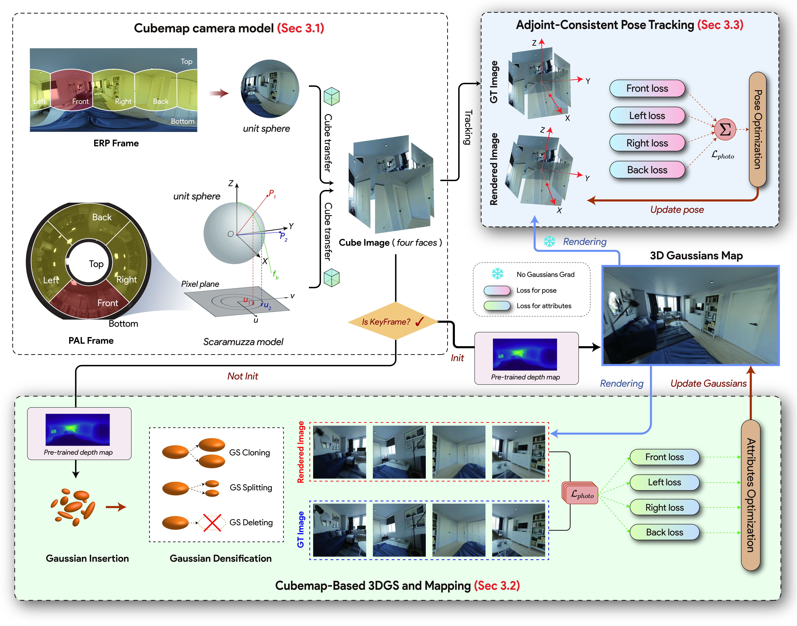
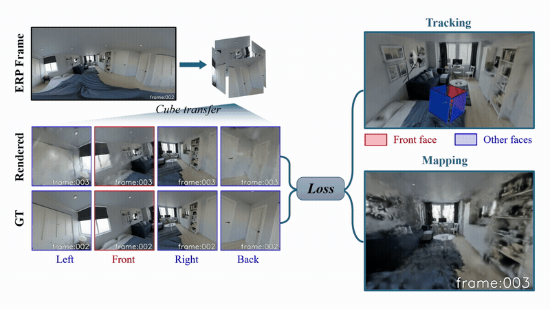

<h1 align="center">Cube-Splat</h1>
<h3 align="center">High-Fidelity 360° Gaussian Splatting SLAM via Cubemap Factorization and Adjoint-Consistent Optimization</h3>

<p align="center">
  Xiangfei Guo · Hao Shi · Yufan Zhang · Zhonghua Yi · Yongqi Mao · Xiaoting Yin · Kaiwei Wang
</p>

<p align="center"><strong>🎉 Accepted to ECCV 2026!</strong></p>

<p align="center">
  <a href="https://link.springer.com/chapter/10.1007/978-3-032-37255-0_12"></a>
  <a href="https://arxiv.org/abs/2609.21347"></a>
  <a href="https://github.com/guoxf304/CubeSplat"></a>
  <a href="https://www.youtube.com/watch?v=7ZAjwrDWoHw"></a>
  <a href="https://github.com/guoxf304/SynPano-Dataset"></a>
</p>

**Cube-Splat** tracks camera motion and reconstructs dense 3D Gaussian maps from panoramic images. Four cubemap views share one camera pose, with adjoint-consistent gradients combining their observations for tracking and mapping.

## 🧩 Pipeline

<p align="center">
  <a href="assets/fig2.pipeline.jpg"></a>
</p>

## 🎬 Demo

<p align="center">
  
</p>

## ⚙️ Installation

Tested with **Ubuntu 22.04 · Python 3.9 · PyTorch 2.0.1 · CUDA 11.8 · RTX 3090**. The environment is adapted from [MonoGS](https://github.com/muskie82/MonoGS).

```bash
git clone https://github.com/guoxf304/CubeSplat.git
cd CubeSplat
conda env create -f environment.yml
conda activate cubesplat

export CUDA_HOME=/usr/local/cuda-11.8
export PATH="$CUDA_HOME/bin:$PATH"
bash scripts/build_extensions.sh
CUDA_VISIBLE_DEVICES=0 python scripts/check_environment.py
```

**Build the bundled CUDA extensions:** Cube-Splat uses a modified differentiable rasterizer. Adjust `CUDA_HOME` to your toolkit path. [Detailed setup →](docs/setup.md)

## 📦 Datasets & Depth Model

| Dataset | Format | Configuration |
| --- | --- | --- |
| [SynPano](https://github.com/guoxf304/SynPano-Dataset) | ERP | `configs/ERP/SynPano/example_scene.yaml` |
| [OmniBlender](https://github.com/changwoonchoi/EgoNeRF#dataset) | ERP | `configs/ERP/OmniBlender/example_scene.yaml` |
| [PALVIO](https://github.com/flysoaryun/LF-VIO#download-palvio-dataset) | PAL | `configs/PAL/LF-VIO/ID01.yaml`–`ID10.yaml` |

**SynPano is available on [Hugging Face](https://huggingface.co/datasets/gxfzju/SynPano):** 8 scenes (5 indoor, 3 outdoor), with 1920 × 960 RGB panoramas and camera poses. [Scene previews & release details →](https://github.com/guoxf304/SynPano-Dataset#dataset-overview)

Download the default `apartment` scene directly into the configured location:

```bash
python -m pip install "huggingface_hub==0.36.0"
hf download gxfzju/SynPano --repo-type dataset --include "apartment/**" --local-dir datasets/SynPano
```

Place prepared sequences under `datasets/` and set `Dataset.dataset_path` in the scene configuration. [Data layout & pose formats →](docs/setup.md#prepare-the-data)

For help reproducing the experiments, please contact [guoxf@zju.edu.cn](mailto:guoxf@zju.edu.cn).

For ERP sequences, download the UniFuse checkpoint from [Depth Anywhere](https://github.com/albert100121/Depth-Anywhere#pretrained-weights) and place it at:

```text
depth_em/checkpoints/UniFuse/UniFuse_SpatialAudioGen.pth
```

## 🚀 Run

```bash
# SynPano
CUDA_VISIBLE_DEVICES=0 python slam.py --config configs/ERP/SynPano/example_scene.yaml

# OmniBlender
CUDA_VISIBLE_DEVICES=0 python slam.py --config configs/ERP/OmniBlender/example_scene.yaml

# PALVIO
CUDA_VISIBLE_DEVICES=0 python slam.py --config configs/PAL/LF-VIO/ID02.yaml
```

For headless PALVIO runs, set `Results.use_gui: False`. To evaluate trajectory and rendering quality locally:

```bash
WANDB_MODE=disabled CUDA_VISIBLE_DEVICES=0 \
  python slam.py --config configs/ERP/SynPano/example_scene.yaml --eval
```

Results and Gaussian PLY maps are saved under `results/`. Evaluation includes 26,000 color refinement iterations. [Options & outputs →](docs/setup.md#evaluation)

## 📚 Citation

```bibtex
@inproceedings{guo2026cubesplat,
  title={Cube-Splat: High-Fidelity 360{\textdegree} Gaussian Splatting SLAM via Cubemap Factorization and Adjoint-Consistent Optimization},
  author={Guo, Xiangfei and Shi, Hao and Zhang, Yufan and Yi, Zhonghua and Mao, Yongqi and Yin, Xiaoting and Wang, Kaiwei},
  booktitle={Computer Vision -- ECCV 2026},
  pages={213--231},
  publisher={Springer},
  year={2026},
  doi={10.1007/978-3-032-37255-0_12},
  url={https://link.springer.com/chapter/10.1007/978-3-032-37255-0_12}
}
```

## 🙏 Acknowledgements

Built on [MonoGS](https://github.com/muskie82/MonoGS), [3D Gaussian Splatting](https://github.com/graphdeco-inria/gaussian-splatting), [Depth Anywhere](https://github.com/albert100121/Depth-Anywhere), [UniFuse](https://github.com/alibaba/UniFuse-Unidirectional-Fusion), and [py360convert](https://github.com/sunset1995/py360convert).

Third-party licenses and research/non-commercial restrictions apply. [License details →](docs/setup.md#third-party-licenses)
